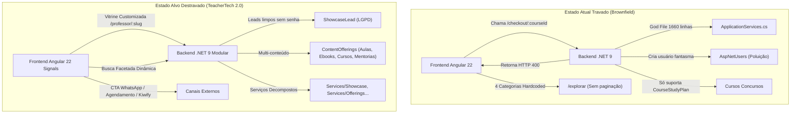
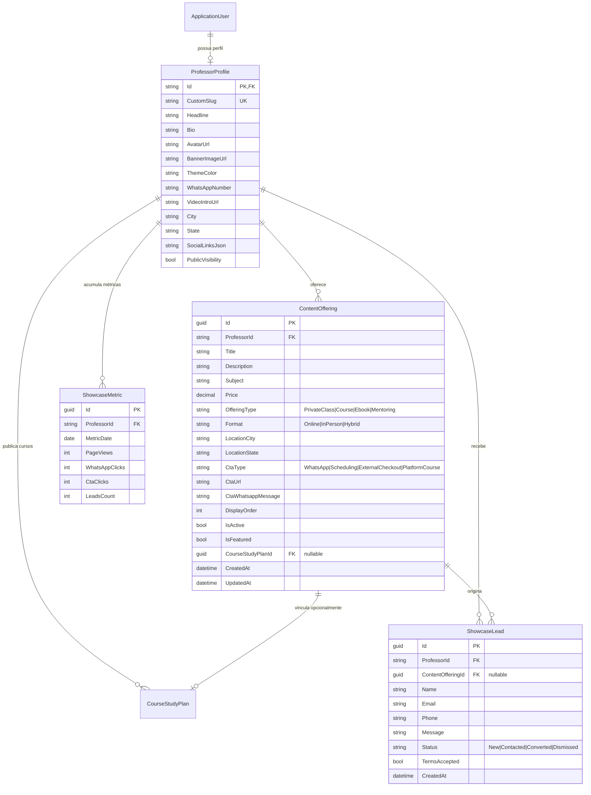

# TeacherTech — Arquitetura Alvo & Plano de Transição

**Documento:** Target Architecture & Transition Plan  
**Versão:** 2.0 (Target Blueprint)  
**Status:** Approved / Architecture Spine  
**Data:** 13 de Outubro de 2026  
**Autor:** Winston (System Architect)  
**Referência:** `docs/prd.md`, `docs/existing-architecture.md`, `docs/gaps-and-tech-debt.md`  

---

## 1. Visão Geral da Arquitetura Alvo

### 1.1. Diagnóstico do Estado Atual ("Arquitetura Travada")
A análise brownfield expôs os nós que mantêm a arquitetura atual travada:
1. **Acoplamento de Domínio Monolítico**:
   - `ApplicationServices.cs` concentra **1.660 linhas** e 8 serviços misturados em um único arquivo de código.
   - `DomainEntities.cs` concentra **513 linhas** com todas as entidades e enums da aplicação.
2. **Dissonância no Funil de Conversão**:
   - O modelo antigo dependia de uma tabela de pagamentos Pix com split (`PaymentDomainService`) cujo checkout avulso foi bloqueado na API (`HTTP 400`), mas o frontend ainda mantém a rota morta `/checkout/:courseId`.
   - Visitantes anônimos que solicitavam acesso na vitrine geravam **usuários fantasmas** na tabela `AspNetUsers` com senhas aleatórias descartáveis.
3. **Vitrine Rígida e Busca Inflexível**:
   - A vitrine `/p/:slug` consulta apenas cursos estruturados (`CourseStudyPlan`), ignorando que a maior fonte de renda do professor autônomo são **aulas particulares presenciais/online, mentorias e e-books**.
   - O `/explorar` possui 4 categorias cravadas no HTML (`explore.component.html`), sem paginação e sem suporte a filtros por formato, matéria ou cidade.



---

## 2. Invariantes Arquiteturais (Architecture Decisions — ADs)

As decisões abaixo representam o **Architecture Spine** que guia toda a implementação dos épicos e histórias:

### [AD-01] Desacoplamento de Ofertas da Entidade de Cursos
- **Binds**: Modelagem de dados e endpoints de vitrine.
- **Prevents**: Obrigatoriedade de criar uma ementa complexa de aulas e tópicos para simplesmente oferecer uma aula particular ou e-book.
- **Rule**: Criar a entidade autônoma `ContentOffering`, vinculada diretamente ao `ProfessorProfile`. Ela suporta múltiplos tipos (`PrivateClass`, `Course`, `Ebook`, `Mentoring`) e formatos (`Online`, `InPerson`, `Hybrid`). Um curso da plataforma pode opcionalmente ser vinculado via `CourseStudyPlanId` nulo.

### [AD-02] Captura de Leads sem Poluição do ASP.NET Identity
- **Binds**: Fluxo de conversão e contato da vitrine.
- **Prevents**: Criação de contas fantasmas no `AspNetUsers` com credenciais descartáveis não verificadas.
- **Rule**: Criar a entidade isolada `ShowcaseLead`. O visitante que manifesta interesse ou envia mensagem pela vitrine é registrado como lead com consentimento LGPD. O professor visualiza e interage pelo painel. Contas no `AspNetUsers` são criadas **exclusivamente** quando o usuário opta expressamente por se cadastrar na plataforma como estudante ou professor.

### [AD-03] Extirpação Segura de Rotas Zumbis e Checkouts Quebrados
- **Binds**: Roteamento Angular e Controllers da API.
- **Prevents**: Visitantes caindo em telas de erro 400 e suporte técnico reclamando de pagamentos quebrados.
- **Rule**: Depreciar formalmente `CheckoutComponent` no Angular e redirecionar a rota `/checkout/:id` para a vitrine do professor criador ou `/explorar`. Marcar `PaymentsController` com `[Obsolete]` e limpar rotas ativas de compra avulsa de cursos.

### [AD-04] Telemetria de Conversão Leve e Não Bloqueante
- **Binds**: Cliques em CTAs de WhatsApp, Agendamento e Links Externos.
- **Prevents**: Perda de métricas pelo fato do usuário sair da página para o WhatsApp ou provedor externo.
- **Rule**: O frontend dispara um evento assíncrono leve (`POST /api/publicshowcase/track-click`) utilizando `navigator.sendBeacon` ou requisição HTTP com cancelamento tolerante, registrando a intenção de contato sem atrasar o redirecionamento do usuário.

### [AD-05] Busca Facetada com Paginação Obrigatória no Backend
- **Binds**: `PublicShowcaseController.ExploreCourses` e queries no Entity Framework Core.
- **Prevents**: Consultas carregando a totalidade de cursos em memória e gargalos de LCP.
- **Rule**: Endpoint `/api/publicshowcase/explore` deve receber parâmetros de paginação (`pageIndex`, `pageSize` default 12) e filtros opcionais combinados (`subject`, `format`, `city`, `priceMin`, `priceMax`, `search`). As agregações de filtros ativos serão providas pelo endpoint dedicado `/api/publicshowcase/filters`.

### [AD-06] Modularização dos "God Files" do Backend
- **Binds**: Organização da camada de aplicação e domínio em `.NET 9`.
- **Prevents**: Conflitos de mesclagem (merge locks), arquivos com mais de 1.000 linhas e testes unitários acoplados.
- **Rule**: A decomposição deve ser realizada por Bounded Contexts em arquivos individuais dentro de diretórios correspondentes, mantendo as interfaces originais para preservar compatibilidade binária.

---

## 3. Modelo de Domínio Alvo & Esquema de Dados



### 3.1. Detalhamento das Novas Entidades C# (.NET 9)

#### A. Expansão de `ProfessorProfile`
Arquivo: `backend/src/TeacherTech.Domain/Entities/Showcase/ProfessorProfile.cs`
```csharp
// Campos adicionados via Migration segura:
public string? BannerImageUrl { get; set; }
public string? ThemeColor { get; set; } = "#4F46E5"; // Default índigo elegante
public string? WhatsAppNumber { get; set; }
public string? VideoIntroUrl { get; set; }
public string? City { get; set; }
public string? State { get; set; }
public string? SocialLinksJson { get; set; } // JSON com Instagram, LinkedIn, YouTube, etc.

// Novas coleções de navegação
public ICollection<ContentOffering> Offerings { get; set; } = new List<ContentOffering>();
public ICollection<ShowcaseLead> Leads { get; set; } = new List<ShowcaseLead>();
public ICollection<ShowcaseMetric> Metrics { get; set; } = new List<ShowcaseMetric>();
```

#### B. Nova Entidade `ContentOffering`
Arquivo: `backend/src/TeacherTech.Domain/Entities/Showcase/ContentOffering.cs`
```csharp
namespace TeacherTech.Domain.Entities;

public enum OfferingType
{
    PrivateClass = 1,
    Course = 2,
    Ebook = 3,
    Mentoring = 4
}

public enum OfferingFormat
{
    Online = 1,
    InPerson = 2,
    Hybrid = 3
}

public enum CtaType
{
    WhatsApp = 1,
    Scheduling = 2,
    ExternalCheckout = 3,
    PlatformCourse = 4
}

public class ContentOffering
{
    public Guid Id { get; set; } = Guid.NewGuid();
    public string ProfessorId { get; set; } = string.Empty;
    public ProfessorProfile Professor { get; set; } = null!;

    public string Title { get; set; } = string.Empty;
    public string Description { get; set; } = string.Empty;
    public string Subject { get; set; } = string.Empty;
    public decimal? Price { get; set; } // Nulo = "Sob Consulta" / Gratuito
    
    public OfferingType OfferingType { get; set; }
    public OfferingFormat Format { get; set; }
    
    public string? LocationCity { get; set; }
    public string? LocationState { get; set; }

    public CtaType CtaType { get; set; }
    public string? CtaUrl { get; set; }
    public string? CtaWhatsappMessage { get; set; }
    public string? CoverImageUrl { get; set; }

    public int DisplayOrder { get; set; } = 0;
    public bool IsActive { get; set; } = true;
    public bool IsFeatured { get; set; } = false;

    public Guid? CourseStudyPlanId { get; set; }
    public CourseStudyPlan? CourseStudyPlan { get; set; }

    public DateTime CreatedAt { get; set; } = DateTime.UtcNow;
    public DateTime? UpdatedAt { get; set; }
}
```

#### C. Nova Entidade `ShowcaseLead`
Arquivo: `backend/src/TeacherTech.Domain/Entities/Showcase/ShowcaseLead.cs`
```csharp
namespace TeacherTech.Domain.Entities;

public enum LeadStatus
{
    New = 1,
    Contacted = 2,
    Converted = 3,
    Dismissed = 4
}

public class ShowcaseLead
{
    public Guid Id { get; set; } = Guid.NewGuid();
    public string ProfessorId { get; set; } = string.Empty;
    public ProfessorProfile Professor { get; set; } = null!;

    public Guid? ContentOfferingId { get; set; }
    public ContentOffering? ContentOffering { get; set; }

    public string Name { get; set; } = string.Empty;
    public string Email { get; set; } = string.Empty;
    public string Phone { get; set; } = string.Empty;
    public string? Message { get; set; }
    
    public LeadStatus Status { get; set; } = LeadStatus.New;
    public bool TermsAccepted { get; set; } = true;

    public DateTime CreatedAt { get; set; } = DateTime.UtcNow;
    public DateTime? ContactedAt { get; set; }
}
```

---

## 4. Contratos de API REST (Target Endpoints)

### 4.1. Vitrine Pública e Catálogo (`PublicShowcaseController`)

| Método | Endpoint | Acesso | Descrição |
| :--- | :--- | :--- | :--- |
| `GET` | `/api/publicshowcase/professors/{slug}` | Público | Obtém perfil completo do professor (incluindo cores, banner, redes e lista de ofertas ativas). |
| `GET` | `/api/publicshowcase/explore` | Público | Pesquisa facetada com paginação: `?subject=&format=&city=&priceMin=&priceMax=&search=&pageIndex=0&pageSize=12`. |
| `GET` | `/api/publicshowcase/filters` | Público | Retorna lista de matérias existentes, cidades ativas e formatos disponíveis para alimentar os filtros do frontend. |
| `POST` | `/api/publicshowcase/track-click` | Público | Telemetria rápida: `payload: { professorId, offeringId, ctaType }`. |
| `POST` | `/api/publicshowcase/leads` | Público | Envio de formulário de contato do visitante para o professor. |

### 4.2. Gestão do Professor (`ProfessorShowcaseController` & `OfferingsController`)

| Método | Endpoint | Acesso | Descrição |
| :--- | :--- | :--- | :--- |
| `GET` | `/api/professor/showcase` | Docente | Obtém dados da vitrine para o editor com Live Preview. |
| `PUT` | `/api/professor/showcase` | Docente | Atualiza slug, banner, avatar, tema, bio, whatsapp e links sociais. |
| `GET` | `/api/professor/offerings` | Docente | Lista todos os conteúdos cadastrados pelo professor. |
| `POST` | `/api/professor/offerings` | Docente | Cria nova oferta (aula, curso, e-book, mentoria). |
| `PUT` | `/api/professor/offerings/{id}` | Docente | Atualiza oferta existente. |
| `DELETE`| `/api/professor/offerings/{id}` | Docente | Remove ou desativa oferta. |
| `GET` | `/api/professor/metrics` | Docente | Retorna dados agregados para o dashboard (views, cliques em CTA, leads). |
| `GET` | `/api/professor/leads` | Docente | Lista leads recebidos com paginação e filtro por status. |
| `PATCH`| `/api/professor/leads/{id}/status` | Docente | Atualiza status do lead (`Contacted`, `Converted`, etc.). |

---

## 5. Arquitetura Frontend (Angular 22 Signals)

### 5.1. Roteamento Limpo e Desacoplado
```typescript
// angular-app/src/app/app.routes.ts
export const routes: Routes = [
  { path: '', redirectTo: 'explorar', pathMatch: 'full' },
  { 
    path: 'explorar', 
    loadComponent: () => import('./components/explore/explore.component').then(m => m.ExploreComponent) 
  },
  { 
    // Rota primária da vitrine
    path: 'professor/:slug', 
    loadComponent: () => import('./components/professor-showcase/professor-showcase.component').then(m => m.ProfessorShowcaseComponent) 
  },
  { 
    // Rota alias retrocompatível
    path: 'p/:slug', 
    redirectTo: 'professor/:slug', 
    pathMatch: 'full' 
  },
  
  // Rotas restritas do professor
  {
    path: 'professor/vitrine',
    canActivate: [authGuard, roleGuard],
    data: { role: 'PROFESSOR' },
    loadComponent: () => import('./components/professor-showcase-editor/professor-showcase-editor.component').then(m => m.ProfessorShowcaseEditorComponent)
  },
  {
    path: 'professor/ofertas',
    canActivate: [authGuard, roleGuard],
    data: { role: 'PROFESSOR' },
    loadComponent: () => import('./components/offerings-manager/offerings-manager.component').then(m => m.OfferingsManagerComponent)
  },
  {
    path: 'professor/dashboard',
    canActivate: [authGuard, roleGuard],
    data: { role: 'PROFESSOR' },
    loadComponent: () => import('./components/professor-dashboard/professor-dashboard.component').then(m => m.ProfessorDashboardComponent)
  },

  // Redirecionamento de rotas legadas descontinuadas
  { path: 'checkout/:courseId', redirectTo: 'explorar', pathMatch: 'full' },
  { path: 'professor/financeiro', redirectTo: 'professor/dashboard', pathMatch: 'full' }
];
```

### 5.2. Gerenciamento de Estado Reativo com Angular Signals
- **`ShowcaseStore`**: Gerencia dados do perfil do professor visualizado, aplicando variáveis CSS reativas no `:root` ou container (ex: `--theme-primary: ${profile.themeColor}`).
- **`ExploreStore`**: Mantém estado dos filtros (`selectedSubject`, `selectedFormat`, `priceRange`, `searchTerm`, `page`), executando debounce automático de 300ms na digitação para evitar rajadas de requisições.

---

## 6. Plano de Migração Passo a Passo (Transição Brownfield)

```mermaid
gantt
    title Roteiro de Migração da Arquitetura (TeacherTech 2.0)
    dateFormat  X
    axisFormat %d

    section Fase 1: Domínio & Schema
    Migration EF Core (Offerings & Leads)   :active, p1, 0, 2
    Decomposição de ApplicationServices.cs   :p2, 2, 4

    section Fase 2: Epic 1 - Vitrine & Busca
    Endpoints Showcase & Busca Facetada     :p3, 4, 7
    Vitrine Angular (/professor/:slug)      :p4, 7, 10
    Catálogo Facetado (/explorar)           :p5, 10, 13

    section Fase 3: Epic 2 - Conversão & CTAs
    Telemetria de CTAs & Captura de Leads   :p6, 13, 16
    Extirpação do Checkout Zumbi            :p7, 16, 17

    section Fase 4: Epic 3 - Painel do Docente
    Editor de Vitrine com Live Preview      :p8, 17, 20
    Gerenciador de Ofertas & Dashboard      :p9, 20, 23
```



### Passo 1: Expansão do Schema no Entity Framework Core
1. Criar as classes de entidade em `TeacherTech.Domain/Entities/Showcase/`.
2. Registrar `DbSet<ContentOffering>`, `DbSet<ShowcaseLead>` e `DbSet<ShowcaseMetric>` no `ApplicationDbContext`.
3. Configurar mapeamentos Fluent API com índices adequados.
4. Gerar migração segura com `dotnet ef migrations add Add_Showcase_MultiContent_And_Leads`.
5. Executar migração sem impacto sobre as tabelas existentes de cursos ou assinaturas.

### Passo 2: Decomposição de `ApplicationServices.cs`
1. Criar a pasta `TeacherTech.Application/Services/Showcase/` e extrair a lógica de vitrine e catálogo para classes isoladas com responsabilidade única (`ShowcaseApplicationService.cs`, `OfferingApplicationService.cs`, `LeadApplicationService.cs`).
2. Manter as interfaces registradas no DI de `Program.cs`.

### Passo 3: Implementação dos Épicos Prioritários
1. **Épico 1**: Destravar Vitrine Personalizável e Sistema de Busca Facetada.
2. **Épico 2**: CTAs Claros (WhatsApp, Agendamento, Checkout Externo) e Captura Limpa de Leads.
3. **Épico 3**: Painel do Professor (Editor de Vitrine, Gestão de Ofertas e Métricas).

### Passo 4: Limpeza do Código Legado
1. Remover o arquivo morto `CheckoutComponent` do Angular.
2. Limpar a dependência do mock `topics.data.ts` (328 KB) que pesava no bundle compilado.
3. Alinhar a suíte de testes xUnit para validar o novo fluxo.
